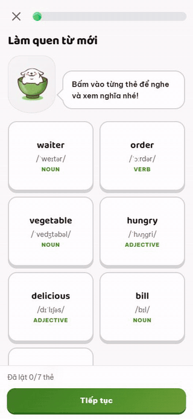
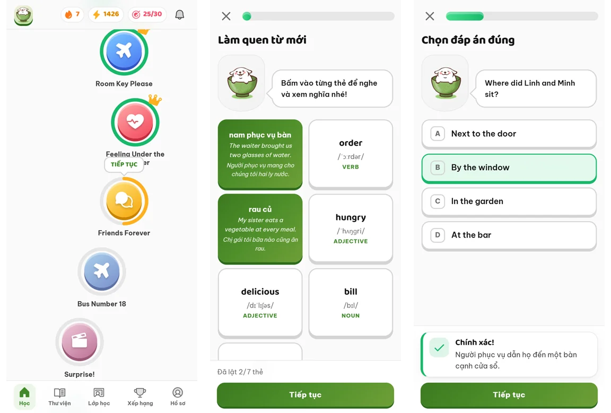
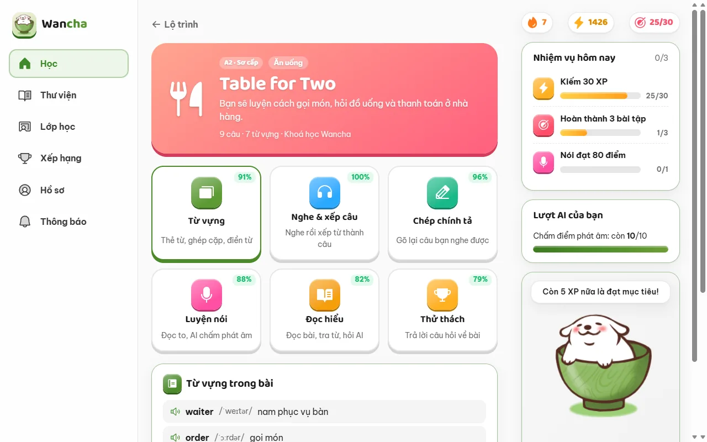
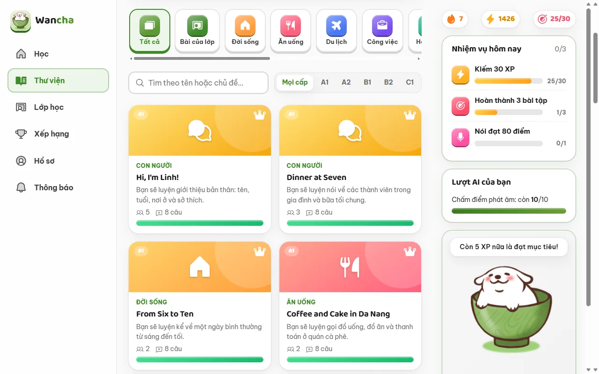
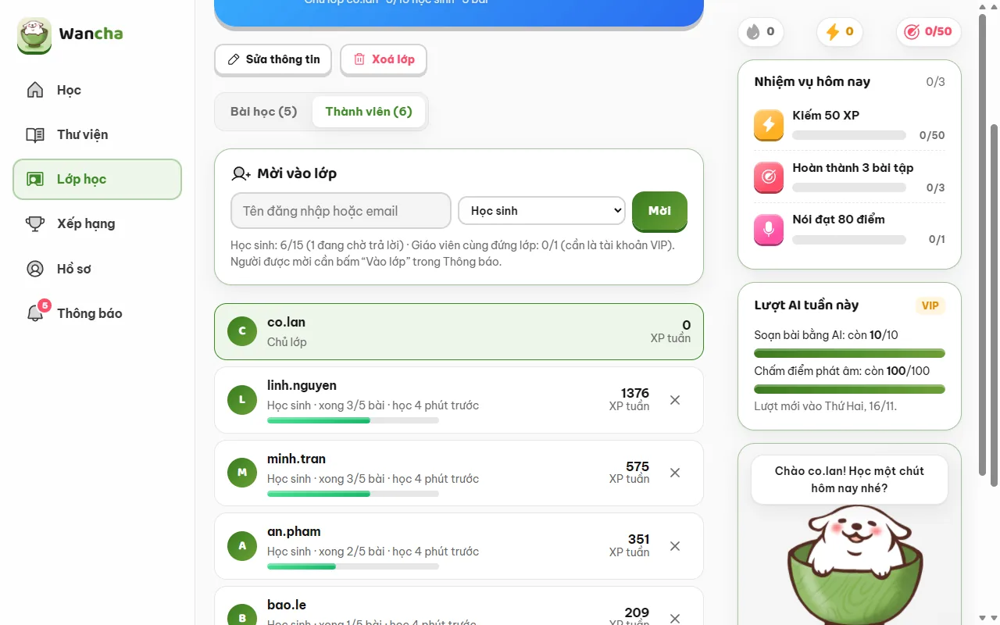
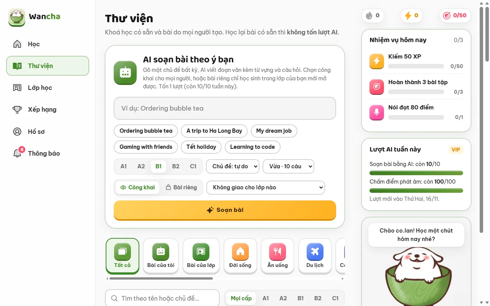
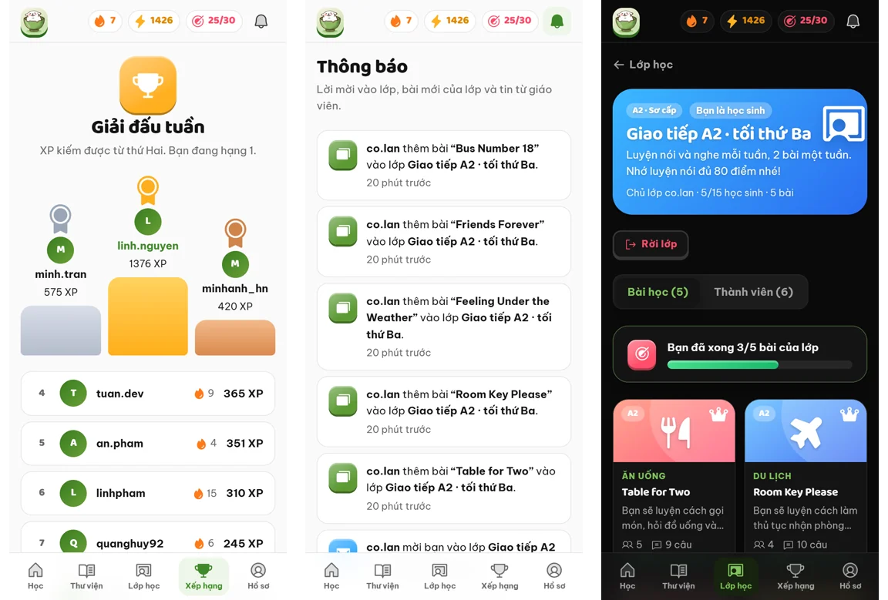
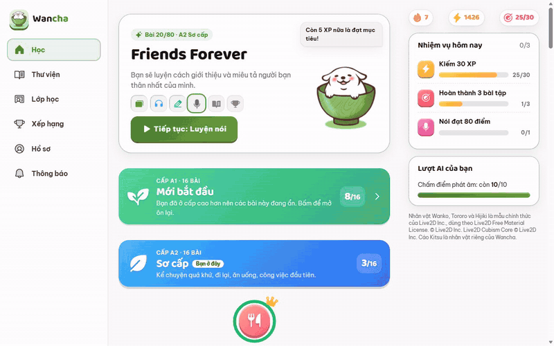
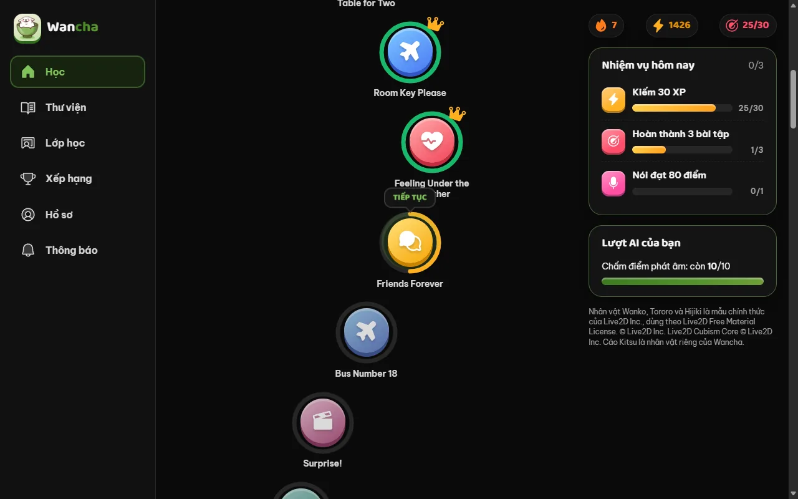
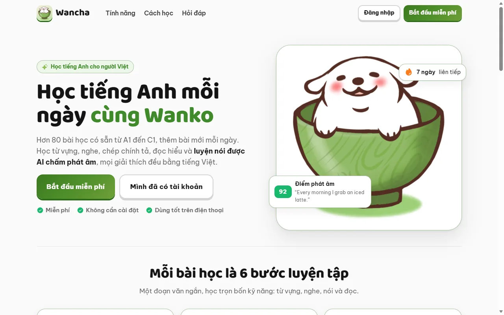

<div align="center">


# Wancha – learn English with Wanko

**Học tiếng Anh mỗi ngày cùng Wanko** · an English practice app for Vietnamese speakers

[](https://github.com/byocao/english-coach/actions/workflows/ci-cd.yml)


**[Mở Wancha → wancha.byocao.com](https://wancha.byocao.com)** · [Báo lỗi / góp ý](https://github.com/byocao/english-coach/issues/new/choose)


</div>

Wancha teaches **reading, listening, dictation and speaking**, with every explanation in Vietnamese. A built-in
course goes from A1 to C1 and grows every day. VIP teachers can write extra lessons with AI and run their own
classes. Speaking is graded by speech recognition plus an AI coach. Everything runs on Cloudflare Workers.

## A lesson in six steps

<table>
  <tr>
    <td width="340" align="center"></td>
    <td>
      <b>Every lesson is a short passage, learnt through six steps:</b>
      <ol>
        <li><b>Từ vựng</b>: flashcards, matching, fill the gap, listen and pick</li>
        <li><b>Nghe &amp; xếp câu</b>: listen, then put the words in order</li>
        <li><b>Chép chính tả</b>: type what you hear</li>
        <li><b>Luyện nói</b>: read aloud; Whisper transcribes and an AI grades 0–100, marking unclear or missing words</li>
        <li><b>Đọc hiểu</b>: read the passage, tap a word to look it up, tap a sentence for an explanation in Vietnamese</li>
        <li><b>Thử thách</b>: a quiz about the passage</li>
      </ol>
      A wrong answer gets a hint and a retry before the answer is shown, and missed items come back in a review round
      at the end of the step.
    </td>
  </tr>
</table>

<p align="center"></p>

## Features

| | |
|---|---|
| 🗺️ **Learning path** | A1 → C1 across 10 topics (daily life, food, travel, work, study, tech, health, fun, nature, people). Each level shows 8 lessons; "Học thêm" unlocks 3 more once those are done. Levels below yours fold away. |
| 🎯 **Placement test** | An adaptive test (up to 12 questions: grammar, vocabulary, listening, reading) starts each learner at the right level. |
| 🔥 **Motivation** | XP, streaks, a daily goal, three daily quests, combos and a weekly league. |
| 📚 **Library** | The course plus lessons written by VIP teachers, filterable by topic and level, 24 per page. |
| 🏫 **Classes** | VIP teachers invite students by username or email, give the class public or private lessons, and follow each student's progress. |
| 🔔 **Notifications** | Class invites (accepted right in the list), replies and new class lessons. |
| 🐶 **Companions** | Wanko (a puppy in a matcha bowl), the cats Tororo & Hijiki, and Kitsu, an original low-poly fox. |
| 🌗 **Light and dark** | Follows the system theme, or pick one in the profile. Works as well on a phone as on a desktop. |
| 🗣️ **Natural voices** | The browser's most natural English voice is picked automatically (e.g. Edge "Natural" voices); learners can choose another. |
| 💬 **Feedback** | "Báo lỗi bài này" on every lesson, and a support card that opens a prefilled GitHub issue form or an email. |

<table>
  <tr>
    <td width="50%"></td>
    <td width="50%"></td>
  </tr>
  <tr>
    <td align="center"><sub>A lesson: six steps with your best score each</sub></td>
    <td align="center"><sub>The library: filter by topic and level</sub></td>
  </tr>
  <tr>
    <td width="50%"></td>
    <td width="50%"></td>
  </tr>
  <tr>
    <td align="center"><sub>Teaching a class: invites, progress, weekly XP</sub></td>
    <td align="center"><sub>VIP: write a lesson with AI, public or just for a class</sub></td>
  </tr>
</table>

<p align="center"></p>

<details>
<summary><b>More: browsing the path and the library (GIF), dark mode, the landing page</b></summary>
<br>
<p align="center"></p>
<p align="center"></p>
<p align="center"></p>
</details>

<sub>Screenshots use demo accounts on a local database.</sub>

Signed-out visitors see a public landing page (prerendered into `index.html` for search engines); sign-in and
sign-up live on their own page.

## How it works

```
Browser (React 19, Vite) ──► Cloudflare Worker (Hono)
                               ├─ D1: users, sessions, lessons, progress, XP, attempts, ai_spend, classes, notifications
                               ├─ Workers AI: Whisper large-v3-turbo (speech to text), Llama 3.3 70B (sentence explanations)
                               └─ Claude API: lesson writing and speaking grades
```

### AI usage and limits

| Feature | Model | Trial / member account | VIP account (per week) |
|---|---|---|---|
| Write a custom lesson | Claude (`LESSON_MODEL`) | Not available | `VIP_LESSON_LIMIT` lessons |
| Grade a spoken sentence | Whisper transcribes, Claude (`GRADE_MODEL`) grades | `GRADE_LIMIT` grades | `VIP_GRADE_LIMIT` grades |
| Explain a sentence | Workers AI (`WORKERS_AI_MODEL`) | Unlimited, within Cloudflare's free daily allowance | Unlimited |

The admin is unlimited. Trial and member allowances are per account and never reset; VIP allowances start again
every Monday at 00:00 Vietnam time. The admin gives or removes VIP (or blocks an account) from the users table.

Every Claude API call is priced from its token usage and stored in `ai_spend`. When a calendar month's spend
reaches `MONTHLY_BUDGET_USD`, lesson writing and grading show a maintenance notice for everyone until the next
month. The admin page shows the month's spend per model and can give an account its uses back.

The speaking score reflects **intelligibility** (whether the recogniser heard the right words); it does not analyse
individual phonemes.

### Classes

VIP accounts (and the admin) can run classes:

- A VIP owns up to `CLASS_LIMIT` classes; each class takes up to `CLASS_STUDENT_LIMIT` students (pending invites
  included) and `CLASS_TEACHER_LIMIT` co-teachers, who must be VIP too. The admin has no class limit.
- Teachers invite by username or by the email on the invitee's profile (optional, one per account, unique, never
  shown to others). Nobody joins a class without accepting the invite.
- A lesson is **public** (in the shared library) or **private**. A private lesson opens only for its author, the
  admin and the members of a class it was added to. Teachers add their own lessons or any public lesson to a class
  and see each student's finished lessons and weekly XP.
- In-app notifications cover invites (accepted or declined right in the list), replies, removals, new class
  lessons and deleted classes.

### Feedback

The profile page has a "Góp ý & hỗ trợ" card, and every lesson has a "Báo lỗi bài này" link. They open the GitHub
issue forms in [`.github/ISSUE_TEMPLATE/`](.github/ISSUE_TEMPLATE) (bug, lesson error, feature request) with the
lesson and device filled in, or an email to the support address. Both addresses live in `src/support.ts`.

### Accounts

Accounts live in D1: a username plus a PBKDF2-SHA256 password hash (20,000 iterations, which fits the Workers Free
CPU limit). Five wrong passwords lock an account for 10 minutes. The admin account is configured with two secrets,
`ADMIN_LOGIN` and `ADMIN_PASSWORD`; its password is never stored in D1 and its username cannot be registered.

## Run locally

```bash
npm install
cp .dev.vars.example .dev.vars        # fill in ADMIN_LOGIN, ADMIN_PASSWORD and ANTHROPIC_API_KEY
npm run db:migrate:local
npm run db:seed:local                 # load the sample course (seed/example)
npm run dev                           # http://localhost:5173
```

Workers AI (Whisper, Llama) needs Wrangler signed in to a Cloudflare account. Without that, run
`EC_OFFLINE=1 npm run dev`: everything else works.

## Deployment

### CI/CD

[`.github/workflows/ci-cd.yml`](.github/workflows/ci-cd.yml):

- **CI** – every pull request and every push to `main`: install, typecheck and build (including the landing-page prerender).
- **CD** – every push to `main` that passes CI: apply pending D1 migrations, deploy the Worker, smoke-test the site.

Repository secrets used by the workflow:

| Secret | Purpose |
|---|---|
| `CLOUDFLARE_API_TOKEN` | Cloudflare API token allowed to edit Workers scripts and routes and D1 |
| `ASSETS_TOKEN` | Read-only access to the private assets repository (see Live2D models below) |

### First-time setup of a new Cloudflare account

1. `npx wrangler login`
2. `npx wrangler d1 create english-coach` and put the returned `database_id` in `wrangler.jsonc`.
3. `npm run db:migrate:remote`, then `npm run db:seed:remote`.
4. Set the Worker secrets:
   ```bash
   npx wrangler secret put ADMIN_LOGIN
   npx wrangler secret put ADMIN_PASSWORD
   npx wrangler secret put ANTHROPIC_API_KEY
   ```
5. `npm run deploy` (afterwards CD takes over).

## Configuration

Plain settings live in `wrangler.jsonc` → `vars`:

| Variable | Purpose |
|---|---|
| `CONTACT_URL` | Where users are sent when they run out of AI uses |
| `LESSON_MODEL` | Claude model that writes custom lessons |
| `GRADE_MODEL` | Claude model that grades speaking |
| `GRADE_LIMIT` | Speaking grades per trial or member account (only VIP and admin write lessons) |
| `VIP_LESSON_LIMIT` | Custom lessons per week for VIP accounts |
| `VIP_GRADE_LIMIT` | Speaking grades per week for VIP accounts |
| `CLASS_LIMIT` | Classes a VIP account can own |
| `CLASS_STUDENT_LIMIT` | Students per class, pending invites included |
| `CLASS_TEACHER_LIMIT` | Co-teachers per class |
| `MONTHLY_BUDGET_USD` | Monthly Claude API spend before lesson writing and grading pause |
| `WORKERS_AI_MODEL` | Workers AI model for sentence explanations |

Worker secrets (`wrangler secret put`, or `.dev.vars` locally; never committed):

| Secret | Purpose |
|---|---|
| `ADMIN_LOGIN` | Username of the admin account (if unset, nobody is admin) |
| `ADMIN_PASSWORD` | Password of the admin account |
| `ANTHROPIC_API_KEY` | Claude API key |

## Built-in course

The live site's lessons are not published here. `seed/example/` has one sample lesson per level so you can see the
format; put your own course in `seed/live/<LEVEL>.json` (gitignored) and the scripts will use it instead. Every
sentence and example carries a Vietnamese translation. Details in [`seed/README.md`](seed/README.md).

```bash
npm run seed:check          # validates format, sentence length, vocabulary appearing in the passage, …
npm run db:seed:remote      # upserts into D1 by slug (safe to run repeatedly)
```

The live course grows by 3 lessons per level every day through a scheduled Claude Code task; the method is in
[`scripts/daily-lessons.md`](scripts/daily-lessons.md).

## Live2D models and credits

Wanko, Tororo and Hijiki are official Live2D sample models, used under the
[Live2D Free Material License](https://www.live2d.com/eula/live2d-free-material-license-agreement_en.html) with credit.
The licence does not allow redistributing the raw model files, so none of them are committed here:

- `scripts/fetch-live2d.mjs` downloads Wanko and the Cubism Core runtime into `public/live2d/` before every
  `dev` and `build`, and recolours Wanko's bowl to matcha green.
- Tororo & Hijiki require accepting Live2D's terms on their download page. Locally, unzip them into `live2d-extra/`
  (gitignored); CD checks them out from a private repository. The build picks up every `*.model3.json` found there.

Kitsu the fox is an original SVG drawing (`src/Fox.tsx`). Icons: [Phosphor Icons](https://phosphoricons.com) (MIT).
